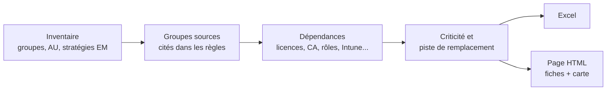
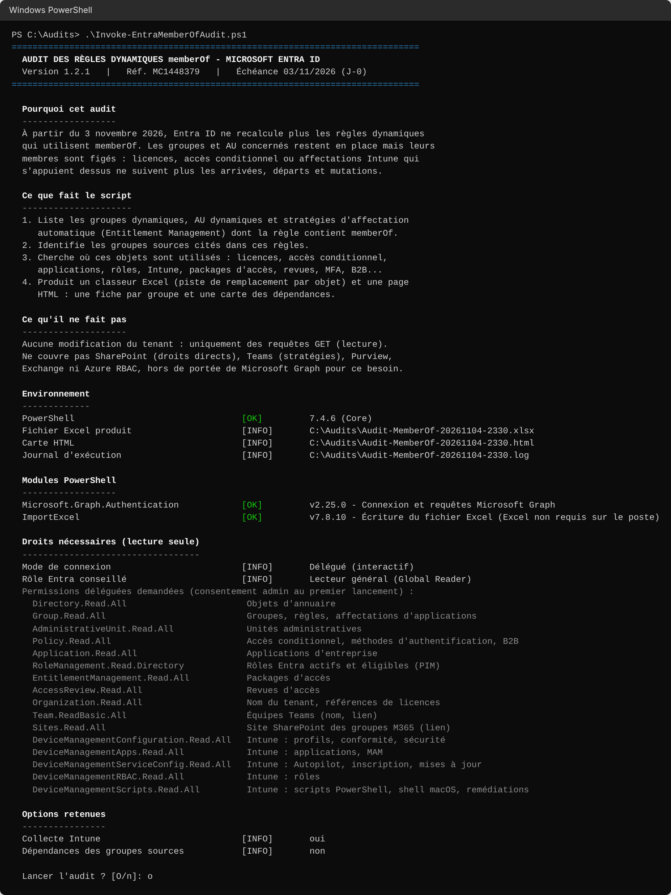
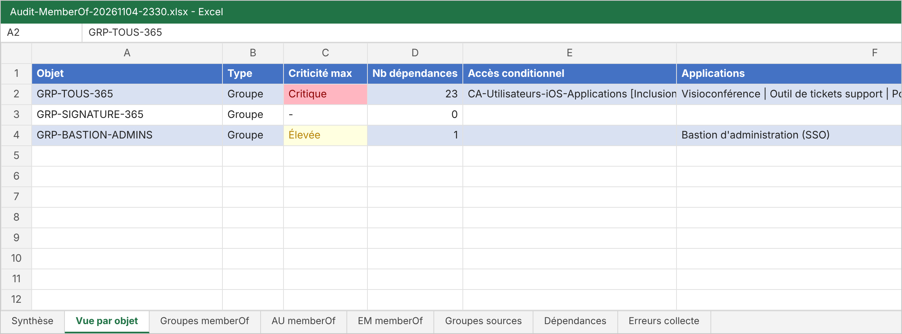
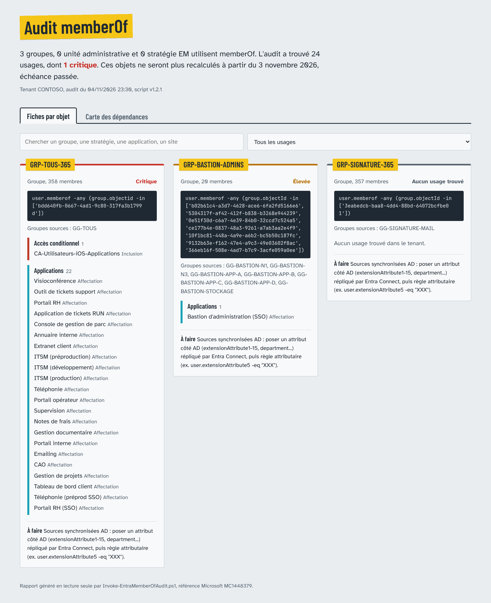
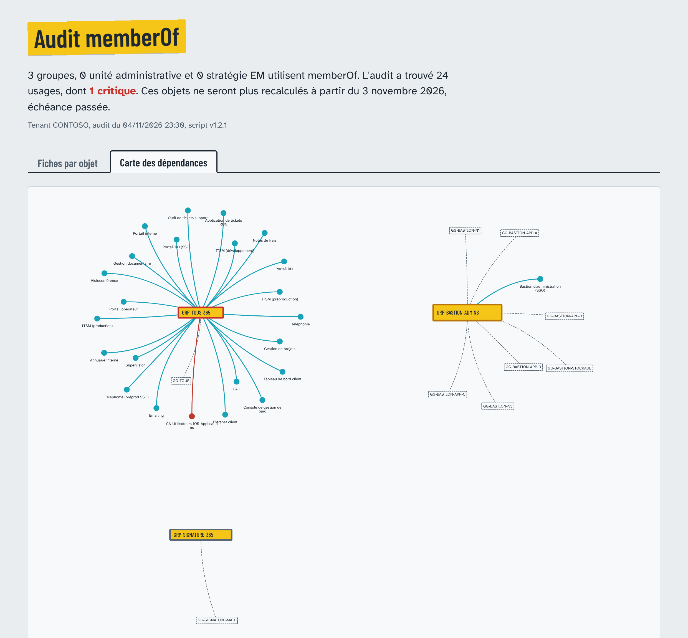

# MyEntra_Audit_dynamicgroup_memberof

Le 3 novembre 2026, Entra ID a arrêté de recalculer les règles dynamiques qui utilisent `memberOf`. Pas d'erreur, pas d'alerte : les groupes concernés se figent.

`Invoke-EntraMemberOfAudit.ps1` recense, en lecture seule, les objets qui utilisent `memberOf` et tout ce qui en dépend dans le tenant, pour corriger dans le bon ordre.

  

L'article qui accompagne ce dépôt : [creaskill.mccool.fr](https://creaskill.mccool.fr/).

## Sommaire

1. [Ce qui change](#ce-qui-change)
2. [Le vrai risque](#le-vrai-risque)
3. [Où un groupe est-il utilisé ?](#où-un-groupe-est-il-utilisé-)
4. [Fonctionnement de l'audit](#fonctionnement-de-laudit)
5. [Prérequis](#prérequis)
6. [Lancer l'audit](#lancer-laudit)
7. [Ce que l'on obtient](#ce-que-lon-obtient)
8. [Remplacer memberOf](#remplacer-memberof)
9. [Ce que l'audit ne voit pas](#ce-que-laudit-ne-voit-pas)
10. [Contenu du dépôt](#contenu-du-dépôt)
11. [Historique des versions](#historique-des-versions)

## Ce qui change

L'opérateur `memberOf` construit un groupe dynamique à partir des membres d'autres groupes :

```text
user.memberof -any (group.objectId -in ['3f1c...'])
```

Resté en préversion, il ralentissait le calcul de tous les groupes dynamiques du tenant. Microsoft y a mis fin le 3 novembre 2026 (Message Center MC1448379) pour :

- les groupes dynamiques, d'utilisateurs comme d'appareils ;
- les unités administratives dynamiques ;
- les affectations automatiques d'Entitlement Management.

## Le vrai risque

Rien n'est supprimé : les membres restent figés au dernier calcul. Les arrivants n'obtiennent pas leurs accès, les partants gardent les leurs, et personne n'est prévenu.

Trouver les règles prend une ligne de PowerShell. Le travail, c'est de savoir ce que chaque groupe alimente pour corriger dans le bon ordre. C'est ce que fait l'audit.

## Où un groupe est-il utilisé ?

Pour chaque groupe ou unité administrative concerné, l'audit liste tous ses usages et leur donne une criticité :

| Usage | Ce qui est remonté | Criticité |
|---|---|---|
| Licences | Licences attribuées par le groupe | Critique |
| Accès conditionnel | Stratégies où le groupe est inclus ou exclu, avec leur état | Critique |
| Rôles Entra | Rôles actifs ou éligibles PIM, administrateurs délégués sur une unité administrative | Critique |
| MFA | Méthodes d'authentification et campagne d'inscription | Critique |
| Intune | Profils, Settings Catalog, ADMX, conformité, sécurité, scripts, remédiations, Autopilot, ESP, mises à jour, applications, MAM, RBAC | Élevée |
| Applications | Applications d'entreprise affectées au groupe | Élevée |
| Teams | Équipe du groupe, avec son lien | Élevée |
| SharePoint | Site du groupe, avec son adresse | Élevée |
| Règles chaînées | Autres groupes ou unités administratives dynamiques construits sur celui-ci | Élevée |
| Packages d'accès | Ressources distribuées, demandeurs, approbateurs | Élevée |
| Accès B2B | Paramètres d'accès inter-locataires | Élevée |
| Exchange | Boîte aux lettres et calendrier du groupe | Moyenne |
| Imbrication | Groupe membre d'un autre groupe ou d'une unité administrative | Moyenne |
| Revues d'accès | Périmètre des revues | Moyenne |

## Fonctionnement de l'audit



Le script interroge Microsoft Graph avec le seul module `Microsoft.Graph.Authentication` (`Invoke-MgGraphRequest`), sans le SDK complet : une seule dépendance, et aucun conflit de versions entre sous-modules.

### 1. Inventaire

- **Groupes** : tous les groupes dynamiques (`groupTypes` contient `DynamicMembership`). La recherche de `memberOf` se fait sur **toute la règle**, pas seulement en début de chaîne, pour ne pas rater les règles mixtes comme `(user.department -eq "Compta") -or (user.memberof ...)`.
- **Unités administratives** : les AU dont `membershipType` vaut `Dynamic` (endpoint beta, le seul qui expose ce champ de façon fiable).
- **Entitlement Management** : la règle d'affectation automatique est enfouie dans la stratégie. Le script cherche `memberOf` dans la stratégie entière, puis en extrait la règle.

### 2. Groupes sources

Les groupes cités dans une règle `memberOf` le sont par leur identifiant. Le script extrait tous les GUID de la règle et les résout un par un. Il passe par `directoryObjects` plutôt que par `groups` : un identifiant qui ne correspond plus à un groupe (objet supprimé, autre type) est signalé au lieu de faire échouer l'audit.

Pour chaque source, il relève le nom, s'il vient de l'AD (`onPremisesSyncEnabled`), s'il est lui-même dynamique et son nombre de membres. Ces trois informations décident de la piste de remplacement proposée.

### 3. Dépendances

Chaque usage se trouve à un endroit différent de Graph :

| Usage | Comment il est trouvé |
|---|---|
| Licences | `assignedLicenses` du groupe, traduit en nom de licence via `subscribedSkus` |
| Accès conditionnel | `includeGroups` et `excludeGroups` de chaque stratégie |
| Rôles | Affectations actives et éligibles ; pour une AU, les rôles dont la portée est cette AU |
| Applications | `appRoleAssignments` du groupe |
| Teams, SharePoint | Équipe et site racine du groupe Microsoft 365, avec leurs liens |
| Règles chaînées | Identifiant du groupe trouvé dans la règle d'un autre groupe ou d'une AU dynamique |
| Intune | Affectations de 19 types d'objets ; si un type refuse `$expand=assignments`, le script lit les affectations objet par objet |
| MFA, revues d'accès, B2B, RBAC Intune | Recherche de l'identifiant dans la configuration complète, car leur structure varie trop d'un objet à l'autre |

Pour cette dernière ligne, le script indique qu'un groupe est **référencé**, sans préciser le champ : le contrôle final se fait dans le portail.

### 4. Criticité et piste de remplacement

Chaque usage reçoit une criticité selon l'effet d'un groupe figé : un nouvel arrivant sans licence ou hors d'une stratégie d'accès conditionnel est plus grave qu'une boîte de groupe incomplète. Chaque objet prend la criticité de son usage le plus grave.

La piste de remplacement dépend des groupes sources :

| Groupes sources | Piste proposée |
|---|---|
| Tous synchronisés depuis l'AD | Règle sur un attribut alimenté dans l'AD et répliqué par Entra Connect |
| Tous dynamiques | Reprendre leurs critères dans la règle, combinés par `-or` |
| Assignés dans le cloud | Groupe assigné, ou package d'accès |
| Introuvables | Nettoyer la règle avant toute autre action |

### 5. Lecture seule

Le script n'envoie que des requêtes `GET`. Si le jeton obtenu contient malgré tout des droits d'écriture, il le signale au démarrage pour qu'on puisse le restreindre. Une collecte qui échoue (droit ou licence manquante) est consignée dans l'onglet *Erreurs collecte* et n'arrête pas le reste de l'audit.

## Prérequis

| Élément | Détail |
|---|---|
| PowerShell | 5.1 ou 7 |
| Modules | `Microsoft.Graph.Authentication` 2.0+ et `ImportExcel` 7.8+. Excel n'a pas besoin d'être installé. |
| Compte | Rôle **Lecteur général**, activé au préalable s'il est éligible dans PIM |

Au lancement, le script contrôle les modules et **propose de les installer** pour l'utilisateur courant, sans droits administrateur. Sous PowerShell 5.1, il force TLS 1.2 et installe le fournisseur NuGet si besoin. Installation manuelle :

```powershell
Install-Module Microsoft.Graph.Authentication -Scope CurrentUser
Install-Module ImportExcel -Scope CurrentUser
```

Pour un fichier téléchargé : `Unblock-File .\Invoke-EntraMemberOfAudit.ps1`, et si besoin `Set-ExecutionPolicy -Scope Process Bypass`.

### Permissions Microsoft Graph

En mode délégué, un administrateur général doit consentir une fois à ces permissions. En mode application (tâche planifiée), on les accorde comme permissions **Application** à une inscription avec **certificat**. Toutes sont en lecture :

| Permission | Usage |
|---|---|
| `Directory.Read.All` | Objets d'annuaire |
| `Group.Read.All` | Groupes, règles, affectations d'applications |
| `AdministrativeUnit.Read.All` | Unités administratives |
| `Policy.Read.All` | Accès conditionnel, méthodes d'authentification, B2B |
| `Application.Read.All` | Applications d'entreprise |
| `RoleManagement.Read.Directory` | Rôles actifs et éligibles |
| `EntitlementManagement.Read.All` | Packages d'accès |
| `AccessReview.Read.All` | Revues d'accès |
| `Organization.Read.All` | Nom du tenant, références de licences |
| `Team.ReadBasic.All` | Équipes Teams (nom, lien) |
| `Sites.Read.All` | Site SharePoint des groupes Microsoft 365 |
| `DeviceManagementConfiguration.Read.All` | Intune : profils, conformité, sécurité |
| `DeviceManagementApps.Read.All` | Intune : applications, MAM |
| `DeviceManagementServiceConfig.Read.All` | Intune : Autopilot, inscription, mises à jour |
| `DeviceManagementRBAC.Read.All` | Intune : rôles |
| `DeviceManagementScripts.Read.All` | Intune : scripts PowerShell, shell macOS, remédiations |

## Lancer l'audit

Avant de se connecter, le script explique ce qu'il va faire, vérifie PowerShell, les modules et les droits, puis **demande confirmation**. Si on répond non, rien n'est fait.



```powershell
# Interactif
.\Invoke-EntraMemberOfAudit.ps1

# Serveur sans navigateur
.\Invoke-EntraMemberOfAudit.ps1 -TenantId contoso.onmicrosoft.com -UseDeviceCode

# Première passe rapide, sans Intune
.\Invoke-EntraMemberOfAudit.ps1 -SkipIntune

# Tâche planifiée (application et certificat), sans question
.\Invoke-EntraMemberOfAudit.ps1 -TenantId contoso.onmicrosoft.com `
    -ClientId <AppId> -CertificateThumbprint <Empreinte> `
    -OutputPath D:\Audits\memberof.xlsx -Unattended
```

| Paramètre | Rôle |
|---|---|
| `-TenantId` | Tenant cible, obligatoire en mode application |
| `-ClientId`, `-CertificateThumbprint` | Connexion en mode application |
| `-UseDeviceCode` | Connexion déléguée par code d'appareil |
| `-OutputPath` | Fichier Excel (défaut : `.\Audit-MemberOf-AAAAMMJJ-HHmm.xlsx`) |
| `-MapPath` | Page HTML (défaut : même nom que le rapport, en `.html`) |
| `-NoMap` | Ne génère pas la page HTML |
| `-LogPath` | Journal d'exécution (défaut : même nom que le rapport, en `.log`) |
| `-IncludeSourceGroupDependencies` | Cherche aussi les dépendances des groupes sources |
| `-SkipIntune` | Saute la collecte Intune |
| `-InstallMissingModules` | Installe les modules manquants sans poser la question |
| `-Unattended` | Aucune question ; s'arrête avec le code 1 si un module manque |

Aide intégrée : `Get-Help .\Invoke-EntraMemberOfAudit.ps1 -Full`

## Ce que l'on obtient

Les captures qui suivent viennent d'un tenant de production, anonymisé : 10 groupes dynamiques, dont 3 utilisent `memberOf`, pour 24 usages. Le rapport HTML correspondant est consultable en version interactive : [ouvrir le rapport d'exemple](https://htmlpreview.github.io/?https://github.com/BouCloud/MyEntra_Audit_dynamicgroup_memberof/blob/main/docs/exemple/rapport-anonymise.html).

### Le classeur Excel

| Onglet | Utilité |
|---|---|
| Synthèse | Chiffres clés et jours restants, à partager tel quel |
| Vue par objet | Une ligne par groupe, une colonne par usage : on voit d'un coup d'œil où il est utilisé |
| Groupes, AU, EM memberOf | Règle, membres, sources et piste de remplacement |
| Groupes sources | Origine AD ou cloud, dynamique ou non, nombre de membres |
| Dépendances | Un usage par ligne, trié par criticité : la liste de contrôle après correction |
| Erreurs collecte | Ce qui n'a pas pu être lu ; doit être vide pour un audit complet |



### La page HTML

Un fichier autonome, à ouvrir dans un navigateur ou à transmettre.

**Fiches par objet** : chaque groupe a sa fiche, avec sa règle, ses sources, ses usages classés par type et la piste de remplacement. Les liens mènent directement à l'équipe Teams et au site SharePoint. Un filtre texte et un filtre par usage permettent de s'y retrouver.



**Carte des dépendances** : les groupes sources, les groupes concernés et ce qu'ils alimentent. Chaque groupe concerné est posé sur une grille et ses usages s'organisent autour de lui. Un élément partagé, comme une stratégie d'accès conditionnel utilisée par trois groupes, n'apparaît qu'une fois. La carte charge la bibliothèque vis-network depuis un CDN ; hors ligne, les fiches restent utilisables.



## Remplacer memberOf

Le plus souvent, le groupe intermédiaire ne sert à rien : on peut brancher les services directement sur les groupes sources.

| Usage | Solution sans nouveau groupe |
|---|---|
| Accès conditionnel, Intune | Cibler les groupes sources, ou les imbriquer dans un groupe assigné : ces services suivent l'imbrication |
| Licences, applications | Affecter chaque groupe source : l'imbrication n'est pas suivie, mais une personne présente dans deux groupes ne compte qu'une fois |
| Stratégies administrateurs | Condition « Rôles d'annuaire » de l'accès conditionnel, sans groupe |

Un groupe AD utilisé directement doit être un groupe **de sécurité**. Une liste de distribution se convertit en groupe de sécurité universel dans l'AD et garde son adresse.

Quand il faut vraiment un groupe à plat (équipe Teams, unité administrative) :

| Groupes sources | Solution |
|---|---|
| Synchronisés depuis l'AD | Une règle sur un attribut déjà renseigné (service, société, suffixe d'UPN, `dirSyncEnabled`), ou un attribut AD (`extensionAttribute1` à `15`) répliqué par Entra Connect |
| Dynamiques | Reprendre leurs critères dans la règle, combinés par `-or` |
| Assignés dans le cloud | Convertir en groupe assigné, ou passer par un package d'accès |

```text
Avant : user.memberof -any (group.objectId -in ['<Id GG-Siege>'])
Après : user.extensionAttribute5 -eq "SIEGE"
```

> **Avant de convertir** : passer un groupe dynamique en groupe assigné supprime tous ses membres. Exportez la liste avant la conversion et réinjectez-la juste après, sinon licences et stratégies tombent pour tout le monde.

Dans l'ordre : traiter d'abord les objets critiques, tester chaque nouvelle règle sur un groupe de test, comparer les membres, basculer, vérifier les usages, puis relancer l'audit jusqu'à ce qu'il ne trouve plus rien.

## Ce que l'audit ne voit pas

Microsoft Graph n'expose pas tout. À contrôler à part :

- droits SharePoint ou OneDrive donnés directement à un groupe de sécurité ;
- stratégies Teams affectées par groupe ;
- Purview (DLP, rétention, étiquettes) et Defender ;
- Exchange : règles de transport, délégations ;
- RBAC Azure ;
- outils tiers qui lisent un groupe par leur propre connecteur (signatures de mail, par exemple). Un groupe sans aucun usage trouvé mérite donc une vérification.

## Contenu du dépôt

```text
├── Invoke-EntraMemberOfAudit.ps1          script d'audit
└── docs/
    ├── exemple/rapport-anonymise.html     rapport HTML réel, anonymisé
    └── images/                            captures
```

Le `.gitignore` exclut les rapports (`.xlsx`, `.log`, `.csv`) : ils contiennent des données du tenant.

## Historique des versions

| Version | Date | Changements |
|---|---|---|
| 1.2.1 | 04/11/2026 | Permission `DeviceManagementScripts.Read.All` ajoutée (scripts Intune et remédiations en erreur Forbidden sans elle) ; carte des dépendances plus lisible |
| 1.2 | 13/10/2026 | Teams, SharePoint et boîte du groupe détaillés avec liens, onglet « Vue par objet », page HTML (fiches et carte des dépendances) |
| 1.1 | 13/10/2026 | Écran de présentation, contrôle et installation des modules, confirmation, journal d'exécution, vérification du rôle du compte, mode `-Unattended` |
| 1.0 | 12/10/2026 | Inventaire, dépendances, export Excel |

## Références

- Microsoft 365 Message Center : MC1448379, *Microsoft Entra ID: Replace MemberOf rules by November 3, 2026*
- [Règles d'appartenance dynamique, Microsoft Learn](https://learn.microsoft.com/entra/identity/users/groups-dynamic-membership)
- Article détaillé : [creaskill.mccool.fr](https://creaskill.mccool.fr/)

## Auteur

Chris Bousquet, [github.com/BouCloud](https://github.com/BouCloud). Retours bienvenus en issue.

Licence MIT.
